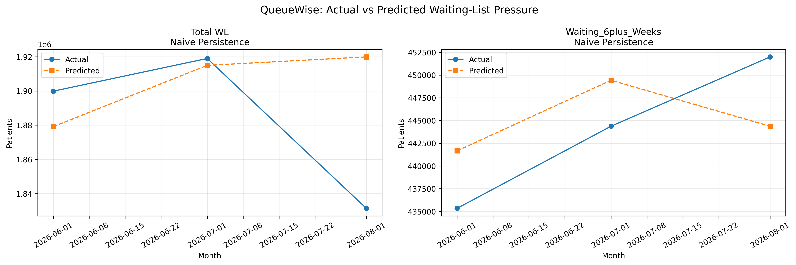
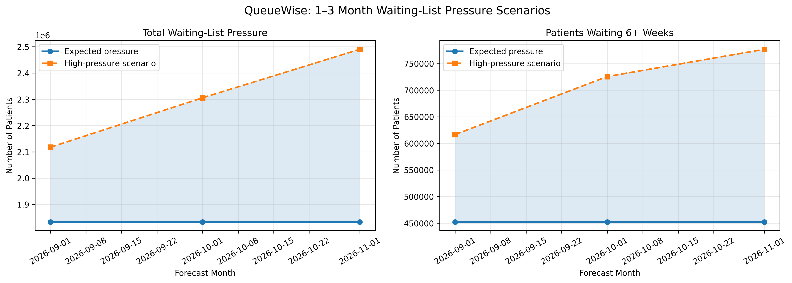

# QueueWise

### An Uncertainty-Aware Forecasting and Capacity-Optimization Framework for Reducing Diagnostic Waiting-List Pressure

  <strong>Forecasting meets data-driven healthcare capacity planning.</strong>

  <a href="https://queuewise-tw82cbi2gjruseps85et9h.streamlit.app/"><strong>Live QueueWise Dashboard</strong></a>

---

## Project Overview

QueueWise is a healthcare analytics and decision-support prototype developed to examine diagnostic waiting-list pressure across NHS England.

The project combines historical diagnostic waiting-list data, provider-level forecasting, empirical uncertainty scenarios and a capacity-allocation simulation. It is designed to help explore where additional diagnostic appointment capacity might be prioritised under different planning assumptions.

QueueWise compares conventional allocation strategies with a forecast-informed, risk-weighted approach and presents the results through an interactive Streamlit dashboard.

**Important:** The forecasts estimate the stock of patients waiting at the end of a reporting period. They do not predict new referrals or patient arrivals.

## Project Objectives

- Prepare and quality-check monthly NHS England diagnostic waiting-times data.
- Forecast total waiting-list size and the number of patients waiting six weeks or longer.
- Compare simple and machine-learning forecasting approaches.
- Represent potential underprediction through an empirical high-pressure scenario.
- Simulate the allocation of additional appointment capacity across provider–service units.
- Compare allocation strategies using reduction, utilisation and fairness measures.
- Present forecasts and simulation results in an interactive dashboard.

## Project Workflow

1. **Data preparation:** Combine, clean and reconcile NHS England DM01 monthly diagnostic waiting-times and activity data.
2. **Forecasting:** Compare Naive Persistence, Linear Regression and XGBoost regression using chronological validation.
3. **Uncertainty analysis:** Estimate empirical underprediction-error uplifts to create a high-pressure stress scenario.
4. **Capacity allocation:** Use a risk-weighted water-filling allocation method subject to budget and provider–service capacity constraints.
5. **Dashboard:** Explore forecasts, compare allocation strategies and inspect provider-level recommendations and assumptions.

## Dataset and Preparation

**Source:** NHS England — Diagnostic Waiting Times and Activity (DM01) monthly extracts.

**Historical reporting period:** September 2024 to August 2026 (24 monthly reporting periods).

The combined provider-level dataset contained:

- **173,600 rows** and **24 columns**.
- **484 providers**.
- **16 diagnostic categories**, including the `TOTAL` category.
- **48 missing provider-name values**, with no missing numerical values or duplicate provider–service–month keys.

The `TOTAL` category was excluded from model-ready data to avoid double-counting the individual diagnostic services. This left **162,750 provider–service–month records across 15 individual diagnostic categories**.

The forecasting targets are:

| Target | Meaning |
|---|---|
| `Total WL` | Total number of patients on the waiting list at the end of the month |
| `Waiting_6plus_Weeks` | Number of patients waiting six weeks or longer |

The six-weeks-or-longer count was derived from the relevant waiting-time categories. An internal reconciliation compared each provider-month `TOTAL` record with the sum of its individual diagnostic services: **10,850 provider-month groups were checked across 24 months, with zero mismatches**. This is an internal consistency check; it is not an independent validation against published NHS national summary totals.

### Feature Engineering

The forecasting workflow used:

- Calendar-aligned 1-, 2- and 3-month lags for waiting-list and activity measures.
- Three-month rolling means.
- Month-to-month growth features.
- Cyclic month-of-year features.
- One-hot encoding for provider and diagnostic-service categories.
- A shared preprocessing pipeline, fitted on the training data only.

Rows without a complete three-month lag history were excluded rather than treating missing history as zero. This produced **140,280 eligible modelling rows**, covering December 2024 to August 2026 (21 eligible target months).

## Forecasting Methodology

Three approaches were evaluated:

| Approach | Description |
|---|---|
| Naive Persistence | Uses the preceding month's observed count as the forecast |
| Linear Regression | Models linear relationships between engineered features and the target |
| XGBoost Regression | Uses gradient-boosted decision trees to model relationships in the data |

### Chronological Data Split

The data were split by time rather than randomly, so later observations were not used to train models evaluated on earlier periods.

| Split | Period | Rows |
|---|---|---:|
| Training | Dec 2024 – Feb 2026 | 99,855 |
| Validation | Mar 2026 – May 2026 | 20,280 |
| Held-out test | Jun 2026 – Aug 2026 | 20,145 |

Models were selected using **validation WAPE**. The held-out test set was reserved for final evaluation.

### Evaluation Metrics

- **MAE (Mean Absolute Error):** Average absolute difference between actual and predicted counts.
- **RMSE (Root Mean Squared Error):** Gives greater weight to larger errors.
- **WAPE (Weighted Absolute Percentage Error):** Total absolute error divided by total actual volume, expressed as a percentage.

WAPE was used as the model-selection metric to compare error relative to the overall waiting-list volume across provider–service records. It is an aggregate metric; it does not mean that every provider has that percentage error.

### Validation Results and Model Selection

| Forecast target | Naive Persistence | Linear Regression | XGBoost |
|---|---:|---:|---:|
| Total WL — WAPE | **9.792%** | 10.265% | 10.698% |
| Waiting 6+ weeks — WAPE | **22.378%** | 23.415% | 22.807% |

**Naive Persistence was selected for both targets** because it achieved the lowest validation WAPE. Linear Regression had a slightly lower validation RMSE, but WAPE was the selection criterion.

### Held-Out Multi-Horizon Performance

The final forecast origin is **August 2026**, with forecasts for September, October and November 2026.

| Forecast horizon | Total WL WAPE | Waiting 6+ weeks WAPE |
|---|---:|---:|
| 1 month ahead | 9.466% | 18.428% |
| 2 months ahead | 14.003% | 30.601% |
| 3 months ahead | 17.730% | 41.141% |

Errors increase with the forecast horizon, particularly for the six-weeks-or-longer target. Although Linear Regression had a slightly lower held-out test WAPE for Total WL, the selected model was not changed after examining the test set; doing so would introduce test-set selection bias.

### Forecast Scenarios

Two scenarios are generated for each provider, diagnostic service and forecast month:

- **Expected scenario:** Naive Persistence carries the August 2026 observed count forward. As a result, the expected value for each provider–service unit remains constant across the three forecast horizons.
- **High-pressure scenario:** Adds a nonnegative uplift based on the 90th percentile of historical underprediction errors estimated from the March–May 2026 validation period.

The high-pressure uplifts were stratified by diagnostic category, target, forecast horizon and historical size band when a group had at least 30 observations. A service-level fallback was used for smaller groups. Uplifts were constrained not to decrease with the forecast horizon, and high estimates for six-week waits were capped at the corresponding high Total WL estimate.

**These high-pressure values are empirical stress-test scenarios. They are not formally calibrated or guaranteed 90% prediction intervals.**

The scenario file contains **20,610 records**: 6,870 August 2026 provider–service combinations, each represented at three forecast horizons.

#### Aggregate Forecast Outputs

| Forecast month | Expected Total WL | High Total WL | Expected Waiting 6+ weeks | High Waiting 6+ weeks |
|---|---:|---:|---:|---:|
| September 2026 | 1,833,070 | 2,117,666 | 452,306 | 616,656 |
| October 2026 | 1,833,070 | 2,305,778 | 452,306 | 725,639 |
| November 2026 | 1,833,070 | 2,490,398 | 452,306 | 776,849 |

These outputs are forecasts relative to the August 2026 data cutoff, not live forecasts refreshed with later NHS data.

### Forecast Visualisations

## Capacity Allocation and Optimisation

The allocation component is implemented in `queuewise_opt.py`. It uses a water-filling method to distribute a configurable appointment-slot budget proportionally to allocation weights while respecting provider–service capacity caps.

The risk-weighted forecast need is:

**Scoreᵢ = Expectedᵢ + λ × (Highᵢ − Expectedᵢ)**

Where:

- `Expectedᵢ` is the expected six-week waiting-list forecast for a provider–service unit.
- `Highᵢ` is its high-pressure six-week waiting-list estimate.
- `λ` is the risk-weighting parameter, ranging from 0 to 1.

The dashboard compares four strategies:

| Strategy | Allocation basis |
|---|---|
| No intervention | No additional appointment slots |
| Equal allocation | Distributes slots equally across eligible units |
| Current backlog | Uses the observed six-week waiting-list count |
| **QueueWise (forecast-informed)** | Uses expected and high-pressure forecasts with a configurable risk weight |

The simulation reports measures such as:

- Reduction in patients waiting six weeks or longer.
- Percentage reduction in six-week waits.
- Remaining six-week waiting-list count.
- Appointment-slot utilisation and unused slots.
- Percentage of units receiving capacity.
- Jain's Fairness Index.

The number of patients assumed to be cleared per additional slot is configurable. This is a simulation assumption, not a measured clinical effect.

## Interactive Dashboard

**[Launch the QueueWise Streamlit Dashboard](https://queuewise-tw82cbi2gjruseps85et9h.streamlit.app/)**

The dashboard provides six sections:

1. **Forecast:** Explore observed, expected and high-pressure waiting-list counts.
2. **Strategy comparison:** Compare no intervention, equal allocation, current-backlog allocation and QueueWise.
3. **Recommended allocation:** Inspect the proposed additional appointment slots by provider and diagnostic service.
4. **Provider view:** Examine provider-level waiting-list forecasts and allocations.
5. **Sensitivity:** Explore how budgets, capacity limits, clearance assumptions and risk weighting affect simulated outcomes.
6. **Method & assumptions:** Review the forecasting, optimisation and scenario assumptions.

Users can filter by forecast horizon, diagnostic service and provider, and switch between expected and high-pressure scenarios.

## Technology Stack

| Area | Tools |
|---|---|
| Programming | Python |
| Data handling | Pandas, NumPy |
| Forecast model experiments | Scikit-learn, XGBoost |
| Optimisation | Custom Python module, water-filling allocation |
| Visualisation | Plotly |
| Dashboard | Streamlit |
| Notebooks | Jupyter Notebook / Google Colab |
| Version control | Git and GitHub |
| Deployment | Streamlit Community Cloud |

The current `requirements.txt` lists the dependencies needed to run the Streamlit dashboard. The forecasting notebooks may require additional modelling packages, including Scikit-learn and XGBoost.

## Repository Structure

~~~text
QueueWise/
│
├── app.py
│   └── Streamlit dashboard
│
├── queuewise_opt.py
│   └── Allocation, water-filling and evaluation functions
│
├── requirements.txt
│   └── Dashboard dependencies
│
├── README.md
│   └── Project overview and documentation
│
├── .streamlit/
│   └── config.toml
│       └── Streamlit theme configuration
│
├── data/
│   ├── QueueWise_Cleaned_Provider_Data (1).csv
│   │   └── Cleaned provider-level historical data
│   └── QueueWise_Forecast_Scenarios.csv
│       └── Expected and high-pressure forecast scenarios used by the dashboard
│
├── notebooks/
│   ├── HA_Capstone_Preprocessing.ipynb
│   └── QueueWise_Forecasting.ipynb
│
├── docs/
│   ├── Member2_Methodology_Results_Limitations.md
│   └── Member3_Handover.md
│
├── figures/
│   ├── QueueWise_Actual_vs_Predicted.png
│   └── QueueWise_Forecast_Scenarios.png
│
└── results/
    ├── QueueWise_24Month_Reconciliation.csv
    ├── QueueWise_Baseline_Results.csv
    ├── QueueWise_Multihorizon_Evaluation.csv
    ├── QueueWise_Test_Model_Comparison.csv
    ├── QueueWise_Uncertainty_Calibration.csv
    └── QueueWise_Validation_Model_Comparison.csv
~~~

## Running the Dashboard Locally

### 1. Clone the Repository

~~~bash
git clone https://github.com/anaghajayarajands25-ops/QueueWise.git
cd QueueWise
~~~

### 2. Create and Activate a Virtual Environment

~~~bash
python -m venv .venv
~~~

**Windows PowerShell:**

~~~powershell
.\.venv\Scripts\Activate.ps1
~~~

**macOS / Linux:**

~~~bash
source .venv/bin/activate
~~~

### 3. Install Dashboard Dependencies

~~~bash
pip install -r requirements.txt
~~~

### 4. Run the Application

~~~bash
streamlit run app.py
~~~

The dashboard will be available at:

~~~text
http://localhost:8501
~~~

Make sure `data/QueueWise_Forecast_Scenarios.csv` is present in the repository. The dashboard loads this file when it starts.

## Limitations and Future Work

### Limitations

- The historical dataset covers 24 months, with 21 eligible target months after lag generation and only three months in each validation and test period.
- Naive Persistence assumes recent observed counts continue; it does not explicitly model new referrals, completed appointments, changes in capacity or policy, or sudden pressure changes.
- Forecast errors increase at longer horizons, especially for six-week waits.
- The data contain many zero-count provider–service records, making emerging waiting lists difficult to anticipate.
- The high-pressure scenario is an empirical stress test, not a formally calibrated prediction interval.
- Internal reconciliation was completed, but independent agreement with published NHS national summary totals has not been established.
- Simulated allocation improvements depend on assumptions such as the number of long waits cleared per additional slot. They are not measured patient outcomes.
- The forecasts are decision-support inputs and should not be treated as operational recommendations without further validation.

### Future Improvements

- Extend the historical data period and evaluate with additional rolling-origin backtests.
- Investigate more advanced time-series and machine-learning forecasting approaches.
- Develop formally calibrated probabilistic forecasts.
- Incorporate changes in referrals, activity, provider capacity and policy where suitable data are available.
- Validate allocation assumptions and recommendations against real operational outcomes.
- Explore additional fairness and service-specific constraints.

## Project Contributors

- **Anagha Jayarajan**
- **Sravana Nambiar**
- **Nakshathra V**

This project was collaboratively developed as an academic healthcare analytics capstone combining data preparation, forecasting, uncertainty analysis, optimisation and dashboard development.

## Disclaimer

QueueWise is an academic and research-oriented decision-support prototype. Forecasts are based on historical NHS England DM01 data, and allocation outcomes are generated through simulation. They are not verified clinical outcomes, guaranteed prediction intervals or operational NHS recommendations.

---

  <strong>QueueWise — Making Healthcare Capacity Planning More Predictive, Fair and Data-Driven.</strong>

